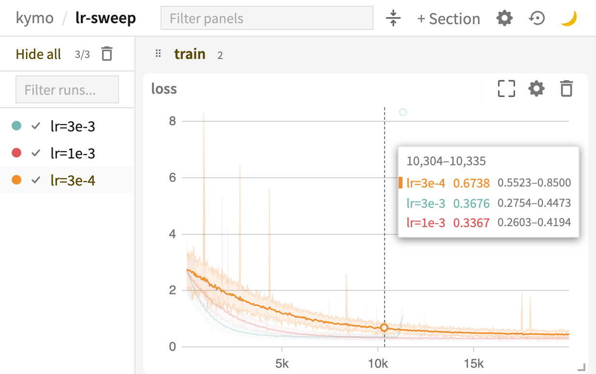

`kymo` is an experiment tracker for machine learning.



- ✅ Correct graphs. Other experiment trackers silently draw your data wrong
- ✅ User-facing parts are good - UI speed and clarity, minimal logging overhead
- ❌ The dashboard can't be put on the internet; all viewers have admin access
- ❌ Vibe-coded; I don't know Rust or Postgres or ClickHouse or webdev
- ❌ Metric (chart) values are coerced to fp32, which will be fixed later but maybe not soon

## Setup

You will run your own backend, since I'm too lazy to make money hosting.

- **Local mode** (recommended) runs the backend on your machine. `pip install "kymo[local]"`
- **Hosted mode** logs to a server which you must separately set up; see [self-hosting](docs/self-hosting.md). `pip install kymo`

Python 3.10+. Linux x86-64 or Apple Silicon Mac, no Windows support. Local mode installs PostgreSQL and ClickHouse, about 700 MB.

## Usage

```python
import numpy as np
import kymo

if __name__ == "__main__":
    kymo.init(mode="local", project_id="demo", run_name="first run", config={"lr": 3e-4})  # Karpathy's favored LR
    for step in range(1000):
        kymo.log({"loss": 1.0 / (step + 1)}, step=step)
    kymo.log({"sample": kymo.Image((127.5 * (1 + np.cos(np.arctan2(*np.mgrid[-1:1:512j, -1:1:512j])[..., None] - np.arange(3) * 2 * np.pi / 3))).astype(np.uint8))}, step=999)
    kymo.open_run()  # opens the dashboard in your browser
    kymo.finish()
```

Keep the `if __name__ == "__main__":` guard: kymo uploads from a helper process, and `spawn` and `forkserver` re-import your script.

The local backend stops after an hour without logging or viewing. `kymo open` restarts it.

Everything else, including wandb import, is in the [client README](python_client/README.md).

This mirrors our internal repository; see [CONTRIBUTING](.github/CONTRIBUTING.md). "kymo" comes from [kymograph](https://en.wikipedia.org/wiki/Kymograph).
